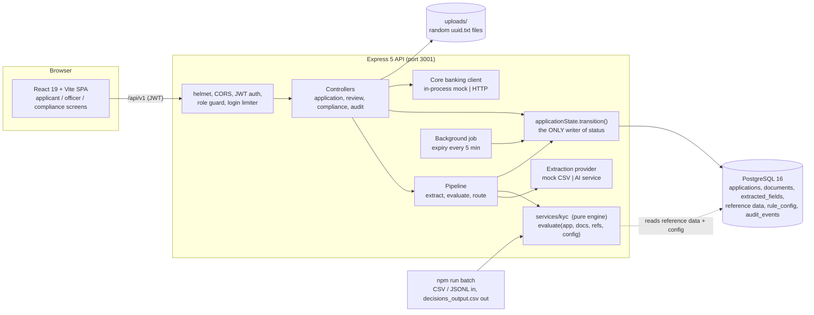
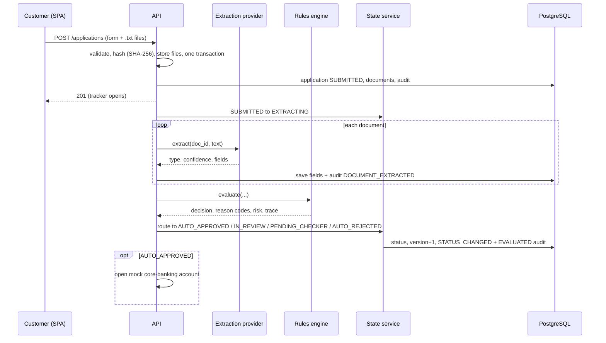
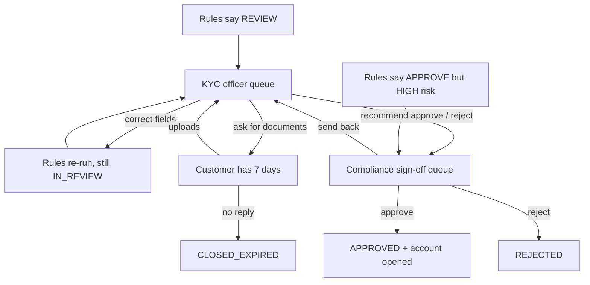

# Architecture

OnboardIQ is a three-tier web application: a React single-page app, a Node/Express API, and PostgreSQL. All business rules live in one pure module that the live app, the tests and the batch command share.

## One engine, three callers

`evaluate()` takes plain objects and returns a decision. It never touches the database, the clock or randomness (the application date is an input). That is why the same function serves:

1. the live submission pipeline,
2. re-evaluation after every officer correction, re-screening and resubmission,
3. `npm run batch` for files, and the unit tests.

## Submission pipeline

If the extraction provider fails, the document is treated as unreadable and the case goes to a human; the customer is never rejected because a service was down.

## Maker-checker

Separation of duties is enforced in the API, not only in the UI: the compliance officer who is recorded as the maker of a case gets 403 on its decision.

## Concurrency and consistency

- Every status change goes through `transition()`: row lock (`SELECT ... FOR UPDATE`), lifecycle check, version check, version bump, audit row, all in one transaction.
- Officer and checker calls carry the `version` they read. A stale version returns 409 `VERSION_CONFLICT`. Tested with two truly simultaneous requests: exactly one succeeds.
- Account opening happens before the checker's status change is committed. If core banking fails, nothing changes (502) and the decision can be retried. Automatic approvals keep their approval and the account can be retried by the compliance officer; creation is idempotent.

## Configuration and reference data

Thresholds (`rule_config`), sanctions and PEP lists, occupations and existing customers are database tables loaded from `data/reference/`. A compliance officer edits thresholds and watchlists in the UI; the next evaluation uses them, and every change is audited with old and new values.

## Technology choices

| Choice | Reason |
|---|---|
| Express 5, plain SQL (`pg`) | Small surface, transactions and row locks are explicit and reviewable |
| zod validators | One schema per request body; same messages reach the form |
| JWT (HS256, 8 h) with role re-read from the database | A demoted user loses access at once |
| PostgreSQL trigger on `audit_events` | Append-only is enforced by the database, not by convention |
| Vite 7 / Vitest 3 with WebAssembly Rollup and esbuild | Runs on locked-down Windows machines that block unsigned native binaries |
| Dockerfiles + `docker-compose.yml` (api, web, db) | One-command run for reviewers; the native-PostgreSQL path stays supported |
