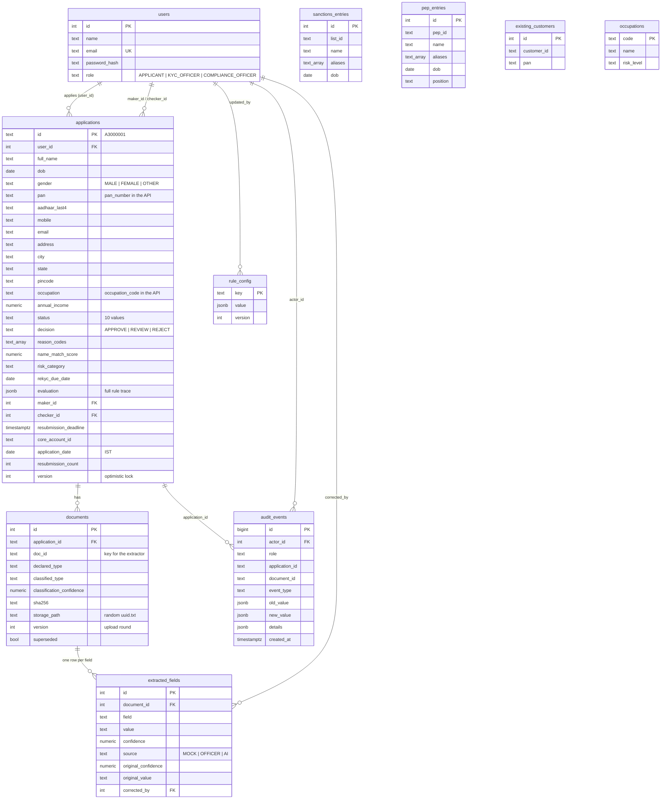

# Data model

`sanctions_entries`, `pep_entries`, `existing_customers` and `occupations` are reference data read by the engine; they have no foreign keys to applications on purpose, so editing a list never alters history. What the engine saw is preserved in `applications.evaluation` and the `EVALUATED` audit rows.

## Integrity rules enforced by the database

- `pan`, `aadhaar_last4`, `pincode`, `mobile` formats and `consent = TRUE` are CHECK constraints.
- `UNIQUE (application_id, sha256)`: the same file cannot be attached twice. A partial unique index keeps one active document per `doc_id`.
- `UNIQUE (document_id, field)`: one value per extracted field; officer corrections upsert and keep the original value.
- `audit_events` has a trigger that raises an exception on UPDATE or DELETE.
- Application ids come from a sequence (`A3000001`, ...), so they never clash with the sample ids (`A2000001`...).
