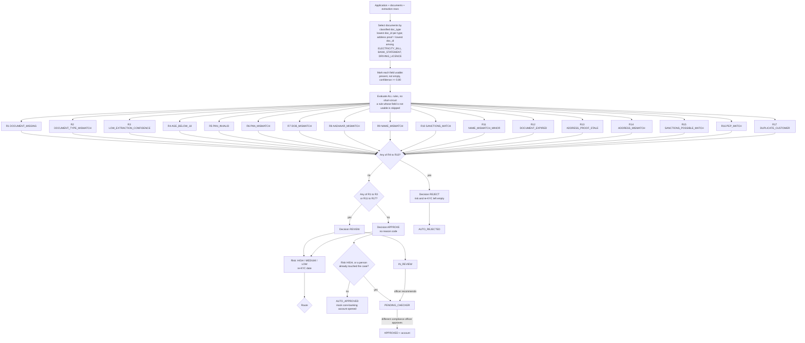

# Rules R1 to R17: evaluation flow, rules, risk and routing

The engine is one pure function, `evaluate(application, documents, refs, config)` in `code/server/src/services/kyc/rules.js`. The live app, the tests and the batch command all call it. It never decides from AI output alone: the extraction service only supplies `doc_type` and field values with a confidence.

## Evaluation and routing flowchart

Reason codes are returned in rule order (R1 first) joined by `|` in the CSV. `REJECT` beats `REVIEW` beats `APPROVE`; every triggered rule is reported, not just the first.

## Definitions

- **Document selection.** Each uploaded document takes the `doc_type` returned by the extraction service. For each type the document with the lowest `doc_id` is used. The address proof is the lowest `doc_id` among `ELECTRICITY_BILL`, `BANK_STATEMENT` and `DRIVING_LICENCE`.
- **Required fields.** `PAN_CARD`: name, dob, pan_number. `AADHAAR_CARD`: name, dob, aadhaar_last4. `ELECTRICITY_BILL` and `BANK_STATEMENT`: pincode, document_date. `DRIVING_LICENCE`: pincode, valid_until.
- **Usable field.** Present, not empty, confidence at least `min_field_confidence` (0.80). Rules R6 to R14 use only usable fields; a rule whose field is not usable is not evaluated. **Poor data never rejects a customer**: it can send the case to review (R3) and nothing more.
- **Age.** Completed years on `application_date` (exactly 18 passes).
- **Name normalisation.** Upper case; `.` and `-` become spaces; every character other than A to Z and space is removed; title tokens (MR, MRS, MS, MISS, DR, SHRI, SMT, KUMARI) are dropped; spaces collapsed; tokens sorted alphabetically and joined by one space. Similarity = 1 minus Levenshtein distance divided by the length of the longer string (1.0 when both are empty). Computed unrounded; rounded to 4 decimals only for output.
- **`name_match_score`.** The lowest similarity between the declared `full_name` and the usable names on the PAN card and the Aadhaar card; empty when neither is usable.
- **Watchlist screening.** The declared `full_name` is compared with each entry's name and alias. MATCH: similarity 0.90 or more and the entry's dob empty or equal to the declared dob. POSSIBLE: similarity 0.90 or more with a different dob, or similarity from 0.80 to below 0.90.

## The 17 rules

| Rule | Reason code | Outcome | Fires when |
|---|---|---|---|
| R1 | `DOCUMENT_MISSING` | REVIEW | No usable `PAN_CARD`, no usable `AADHAAR_CARD`, or no usable address-proof document |
| R2 | `DOCUMENT_TYPE_MISMATCH` | REVIEW | Any document's classified `doc_type` differs from its declared type |
| R3 | `LOW_EXTRACTION_CONFIDENCE` | REVIEW | Any document's type confidence is below 0.80, or a required field of a selected document is missing or below 0.80 |
| R4 | `AGE_BELOW_18` | REJECT | Age below 18 |
| R5 | `PAN_INVALID` | REJECT | Declared PAN does not match `^[A-Z]{5}[0-9]{4}[A-Z]$` or its 4th character is not `P` |
| R6 | `PAN_MISMATCH` | REJECT | Usable PAN on the PAN card differs from the declared PAN |
| R7 | `DOB_MISMATCH` | REJECT | Usable dob on the PAN card or the Aadhaar card differs from the declared dob |
| R8 | `AADHAAR_MISMATCH` | REJECT | Usable `aadhaar_last4` differs from the declared digits |
| R9 | `NAME_MISMATCH` | REJECT | `name_match_score` below 0.75 |
| R10 | `SANCTIONS_MATCH` | REJECT | Sanctions screening result is MATCH |
| R11 | `NAME_MISMATCH_MINOR` | REVIEW | `name_match_score` from 0.75 to below 0.90 |
| R12 | `DOCUMENT_EXPIRED` | REVIEW | Address proof is a `DRIVING_LICENCE` and `valid_until` is before `application_date` |
| R13 | `ADDRESS_PROOF_STALE` | REVIEW | Address proof is an `ELECTRICITY_BILL` or `BANK_STATEMENT` and `document_date` is more than 90 days before `application_date`, or after it |
| R14 | `ADDRESS_MISMATCH` | REVIEW | Usable pincode on the address proof differs from the declared pincode |
| R15 | `SANCTIONS_POSSIBLE_MATCH` | REVIEW | Sanctions screening result is POSSIBLE |
| R16 | `PEP_MATCH` | REVIEW | PEP screening result is MATCH |
| R17 | `DUPLICATE_CUSTOMER` | REVIEW | Declared PAN exists in the existing-customers list |

## Risk, re-KYC and routing

| Category | When | Next KYC |
|---|---|---|
| HIGH | `PEP_MATCH` or `SANCTIONS_POSSIBLE_MATCH` triggered, or the occupation's `risk_level` is HIGH | 2 years |
| MEDIUM | occupation `risk_level` MEDIUM, or annual income of 25,00,000 or more | 8 years |
| LOW | everything else (an occupation code not in the list counts as LOW) | 10 years |

`rekyc_due_date` = `application_date` plus 2 / 8 / 10 years; 29 February moves to 28 February. Risk and re-KYC are empty for REJECT; `name_match_score` is reported (4 decimals) for every decision when it can be computed.

| Engine result | Status |
|---|---|
| REJECT | `AUTO_REJECTED` |
| REVIEW | `IN_REVIEW` |
| APPROVE, risk LOW or MEDIUM | `AUTO_APPROVED` (account opened through the mock core-banking API) |
| APPROVE, risk HIGH | `PENDING_CHECKER` |
| Officer corrected a field or the applicant resubmitted, and the rules now say APPROVE | `PENDING_CHECKER` (a human touched it, so a second person signs) |

A field corrected by a KYC officer gets confidence 1.00 and source `OFFICER`; the rules re-run at once and the original value is kept.

## Configuration (nothing below is a code constant)

Defaults live in `code/server/src/services/kyc/config.js`, are loaded from `data/reference/rules_config.json` (or the HCL file `case_02_rules_config_V1.0.json`) into the `rule_config` table, and can be changed by a compliance officer on the *Rules and lists* page (versioned and audited). The next evaluation uses the new value.

| Key | Default |
|---|---|
| `min_field_confidence` | 0.80 |
| `name_match_threshold` / `name_reject_threshold` | 0.90 / 0.75 |
| `watchlist_match_threshold` / `watchlist_possible_threshold` | 0.90 / 0.80 |
| `min_age` | 18 |
| `pan_pattern` / `pan_holder_char` | `^[A-Z]{5}[0-9]{4}[A-Z]$` / `P` |
| `address_proof_max_age_days` | 90 |
| `name_title_tokens` | MR, MRS, MS, MISS, DR, SHRI, SMT, KUMARI |
| `medium_income_threshold` | 2500000 |
| `rekyc_years` | HIGH 2, MEDIUM 8, LOW 10 |
| `unknown_occupation_risk` | LOW |
| `resubmission_window_days` / `checker_sla_hours` | 7 / 24 |
| `required_fields` | per document type, as above |
