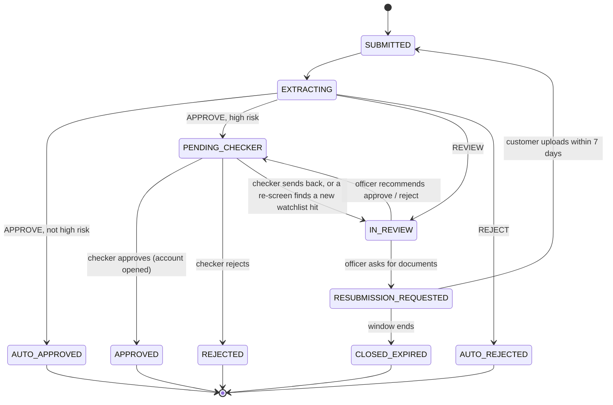

# Application status flow

| Status | Meaning | Who moves it |
|---|---|---|
| `SUBMITTED` | Saved, not yet verified | system |
| `EXTRACTING` | Reading documents and running the rules | system |
| `AUTO_APPROVED` | Rules approved, risk not high; account opened | system |
| `AUTO_REJECTED` | A reject rule fired | system |
| `IN_REVIEW` | Needs a person (any review rule fired) | KYC officer |
| `PENDING_CHECKER` | Waiting for final sign-off | compliance officer |
| `RESUBMISSION_REQUESTED` | Customer must upload corrected documents | customer / timer |
| `APPROVED` / `REJECTED` | Final human decision | compliance officer |
| `CLOSED_EXPIRED` | 7-day window passed | timer (also checked on every read) |

Rules that apply to every move:

1. Only `applicationState.transition()` changes `status`. It rejects any move not in the table above (409 `INVALID_TRANSITION`).
2. A human-touched approval (after an officer correction or a resubmission) always goes through `PENDING_CHECKER`.
3. Terminal statuses never reopen. A resubmission re-enters at `SUBMITTED` from `RESUBMISSION_REQUESTED` only.
4. Each move writes a `STATUS_CHANGED` audit row; the customer's timeline is built from those rows.
